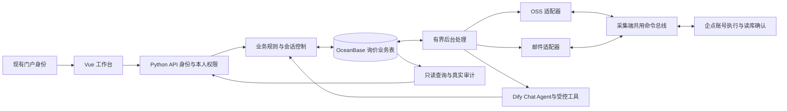

# 现券询价平台最小整改设计

安琳，推荐保留现有 Vue 工作台和 Python 服务，收敛为**一个Chat Agent与一处强制执行约束、一个业务事务库、OSS与邮件两个适配器、采集端一个执行入口**。不按40条问题各加一层补丁，也不重建微服务平台。核心改动是消除重复的状态来源，让授权、谈价、停止和真实发送沿同一条链执行。

日期：2026-10-13。状态：**供安琳评审的设计稿，尚未实施**。依据：[本次40项评审](2026-10-13-code-review.md)、当前工作树、现有功能文档及本轮澄清。历史文档中的规划或推断不自动成为本期要求。

**本轮后续裁决已更新**：聊天核心以[Dify Chat Agent新方案](2026-10-13-dify-chat-agent-design.md)为准，Agent可主动查证、比较、选择授权内策略及自然对话；实价但gap>0可继续争取，gap≤0或触停转人工。OSS按[STS接入设计](2026-10-13-sts-integration-design.md)申请临时凭据，认证令牌用SM4-CBC，正文格式不变。旧的“只抽取/固定整句话术/实价即停”不再是新实现规格。

独立设计复核已完成一轮修订：补齐主通道切换完成条件、迟到ACK的版本隔离，以及状态归档/行情配置/查询容量约束。复核方确认原提出的三项问题均关闭；这只是设计修订的限定通过，不代表代码或真实链路验收通过。D10/D11仍等待产品选择，其余通用设计已形成可审阅方案。

**一、已经确认的产品边界**

| 编号 | 安琳已确认的决定 | 设计结果 |
|---|---|---|
| D01 | 人工确认询价批次和策略后由Chat Agent在授权内谈价；实价且gap>0可继续，gap≤0或触停转人工 | Agent可选择策略和报价提案；服务端核数值及权限；始终不可成交 |
| D02 | 企业内网多人使用，登录参考 nanyin-deposit-agent；OceanBase 同该项目 | 复用现有集成方式，询价业务表独立；不另建身份系统 |
| D03 | 同时5人、5企点账号，一人一号 | 固定归属，无跨席位借号、抢占、转让或多级审批 |
| D04 | OSS 和邮件双通道本期都要完整交付 | 两路都必须完成上行、下行、回执、恢复和停止验收 |
| D05 | 每个绑定择一主用，人工切换；结果未知先对账 | 不自动双投，不以切换通道绕过未决结果 |
| D06 | 同对手允许多券并行；唯一归属才自动谈价；歧义可查证并发一次中性澄清，仍不明转人工 | 不取消批量询价；不靠最近时间或价格猜挂价；澄清额度服务端维护 |
| D07 | BP与绝对收益率自动谈价；净价先转人工 | 净价可以显示，不作未经验证的收益率替代或自动换算 |
| D08 | 交易员填写并确认询价方向和本次数量上限 | 不虚称已接通 OT、授信、可投量自动校验；对方要求超量即人工 |
| D09 | 各人只看自己的聊天、策略、询价和导出；公共行情共享 | 服务端实施数据隔离；公共行情中不混入他人的内部意向 |

补充：已授权对手可以被动闲聊维护关系，停止/接管仍优先；完整债券及发行人主数据待现场接库，先留插口并明示缺失；Dify0.15.3允许提出升级，当前不执行。

两项交互减法正在征求确认：D10 每页50行的服务端分页替代无限滚动，保留全量筛选和跨页选择；D11 是否交付真正 `.xlsx` 导出。其余设计不依赖这两项的回答。

**二、为什么采用这条路线**

| 方案 | 能解决什么 | 代价与结论 |
|---|---|---|
| 只在现有 JSON、页面覆盖态和发送函数上加检查 | 少量局部错误 | 无法可靠解决跨进程恢复、双通道去重、停止在途消息和多人隔离；不推荐 |
| **现有单体内收敛业务与状态，复用采集端总线** | 覆盖40项评审的主要根因，保留当前页面和技术栈 | 需一次业务状态迁移和两端协议联调；推荐 |
| 重建微服务、消息中间件、通用工作流和权限平台 | 为更大规模扩展留空间 | 当前5人5号没有对应收益，增加运维与一致性成本；不采用 |

本期不引入 Redis、Kafka、Celery、通用工作流引擎、事件溯源框架、Pinia 或新 UI 库。审计采用追加记录，但不要求从所有审计事件重放出整个系统。数据库使用一条已确认的 OceanBase/MySQL 协议路径，不同时建设多套生产方言。

**三、复用的代码与真实改动范围**

本轮已只读核对下列源码，没有连接这些项目的真实数据库或账号。

| 现有资产 | 复用方式 | 不照搬的部分 |
|---|---|---|
| `qtrade/ibquote/src/njcb_deposit_agent/routers/auth.py` | 门户 SSO 入参、服务端签名校验、用户ID与展示名、硬性身份依赖 | 开发模拟登录、默认密钥、失败后开放开发入口、软401业务体 |
| `qtrade/ibquote/web/src/api/client.ts` 与 `App.vue` | 统一认证头、401处理、启动校验、登录后清理URL参数 | 不沿用 `ibq_*` 存储键覆盖存款平台会话 |
| `qtrade/ibquote/src/njcb_deposit_agent/db/core.py:491-535` | MySQL协议连接、显式事务初始化、短连接作用域和超时 | 不复制整个PG/Gauss兼容层，不直接导入另一仓库的 settings |
| `qtrade/ibquote/src/njcb_deposit_agent/db/queue.py:126-189` | 条件更新认领、归属令牌复核思路 | 不照搬存款业务表和解析状态；模型重试与真实发送重试分别处理 |
| 本仓 `relay/side_b/engine.py`、`phrase.py` | 复用确定性方向/边界检查和安全收口措辞；Agent负责策略与自然语言提案 | 不复用自动创建会话、默认方向/量、`abs()`丢符号、实价一律停止、JSON持久化及旧调度入口 |
| 本仓 `imlink/oss_catalog.py`、`oss_send.py` | 对象访问、目录/通讯录解析和现有兼容线格式 | 不复用“超时即永久失败”的同步等待状态机 |
| 采集端 `qtrade_agent/ossbox/inbox.py`、`mail/`、`bus/` | 已有OSS下行、SMTP/IMAP、验签、邮件队列、账号执行器与命令总线 | OSS直调发送、两路不同幂等命名、内存去重、硬编码不补发ID列表 |
| `web/src/lib/quoteCore.ts`、`quoteWorker.ts`、`quoteClient.ts` | 现有合批、连接与500ms拉取机制 | 不再同时保留无调用的 RowStore 和另一套页面状态实现 |

采集端当前运行入口引用的源码位于 `/mnt/c/Users/anlin/Desktop/work/src/qtrade_agent`，其工作树有未提交修改。本次已核实有 `XunjiaInbox`；因此不重造一个 OSS 命令消费者。真正欠缺的是：OSS下行接入同一bus、企点新消息的双通道上报接线、内网消息消费及统一对账、取消守卫。2026-10-10冻结副本仅作对照，不当作现役版本。详见[传输复用证据](2026-10-13-design-evidence/transport.md)。

**明确跨仓库边界**：本仓负责内网业务、API、UI、规则和消费；采集端负责真实企点执行、原生消息身份、执行去重、取消和两路消息发布。仅修改本仓不能通过“双向收发与远端停止”验收。存款项目只作为参考，不修改其业务或数据库表。

**四、最终结构与职责**

首版以一个 Python 服务进程管理 API 和后台任务生命周期，部署明确 `workers=1`。5个浏览器并发不要求5套服务或5套消费者。外部调用异步/有界执行，初始最多5个模型任务同时运行，同一个对话按入站顺序串行处理；不同对手、不同券可以同时处于谈价中。技术并发限制不是业务询价数量限制，不引入“超时自动继续让价”。

服务端只保留一个后台调度入口：消费入站、调用模型、运行规则、提交命令、对账。GET 只查数据，关闭浏览器不停止已授权业务。默认不自动启动第二个副本争抢外发；部署唯一实例和数据库认领共同约束重复执行。未来确需高可用时，再对部署和执行租约做专项设计，本期不承诺无停机切换。

代码调整按职责收敛，不先机械搬目录：

| 职责 | 目标位置或处理方式 |
|---|---|
| 明确生产入口与装配 | 小型 `server/app.py`；旧 `mock/mock_server.py` 分离出真实路由，mock仅测试/显式演示启动 |
| 认证与本人账号 | `server/auth.py`，复用已核实的SSO模式，应用独立密钥/存储命名 |
| 事务访问和迁移 | `server/db.py` 与 `db/mysql/`；只封装本项目必要SQL |
| 会话、确认、停止、接管和底价 | 将 `imlink/inquiry_rules.py` 与相关路由整理为一个业务服务边界 |
| Chat Agent接入 | `imlink/dify_inquiry.py`改为chat-messages、逐对话上下文/提案合同；移出发送线程和全局active读取 |
| 强制约束与安全收口 | 从旧relay迁入确定性价差/方向/边界检查，接统一提案审核；自然对话由Agent承担 |
| 命令和后台执行 | `imlink/commands.py`负责持久命令；一个 `imlink/runner.py`负责调度 |
| OSS与邮件 | 保留OSS代码，增加薄邮件适配器；共用业务信封和结果类型 |
| 前端 | 四页布局及组件保留；API统一契约，删除模拟成功和长期覆盖态 |

以上是责任划分，不要求为每个名词建一个类或包。实际文件拆分随改动量确定；单一函数可清楚表达时不加工厂、插件注册、仓储基类或配置DSL。

**五、一处保存一种事实**

业务持久状态写入与存款平台同类的 OceanBase/MySQL 协议环境，但使用询价独立库/表命名及最小权限。公共主数据只读，不能把询价状态写回存款主数据源表。连接目标、租户模式和版本在实施前用受控测试库核实；本稿没有验证线上事务行为。

建议保留以下8类简单表，不为每个状态另建表：

| 数据 | 保存什么 | 为什么不能只放前端或JSON |
|---|---|---|
| `account_binding` | user_id到企点号的固定归属、工作台、主用通道、配置版本、本人机器人开关；凭据仅保存安全引用 | 权限和账号身份必须独立于浏览器当前选择 |
| `rfq_batch` | 草稿、已解析对象集、收件人、确认人/时间、策略版本、正文摘要和幂等请求ID | 全选及人工确认必须可重读，不能提交时重新扩大集合 |
| `conversation` | account+会话类型+peer、接管状态、control_version、恢复后的入站水位 | 同对手多券共享对话，人工接管有明确范围 |
| `rfq_session` | batch/意向、券、方向、策略快照、当前已确认报价、已问量标记、业务状态、revision、pending_command_id | 同券不同人/对手/批次不能覆盖；不能仅按code保存状态 |
| `message` | 完整原文、来源账号和peer、稳定消息ID、序号/修订、处理元数据、归属证据 | 双路重收不重复处理，历史可回看且不触发补答 |
| `command` | 不可变command_id、账号/peer、关联会话、正文和摘要、授权版本、有效期、执行状态 | 内网提交与外部执行不是同一事务，需要持久待执行记录 |
| `audit_event` | 授权、规则、接管、回执及冲突的追加事实，引用原文/命令ID | 真实追踪和导出不能从UI状态反推或随机生成 |
| `consumer_cursor` | 各绑定/传输持久读取位置和代次 | 重启、邮件UIDVALIDITY变化、重复对象需要可恢复水位 |

行情沿用“源数据、最新报价、必要流水”的专用结构，不把每个行情tick放进询价业务命令表。消息正文不在多份业务JSON中反复复制；审计尽量引用message_id/command_id。状态查询是这些表的汇总，没有单独 `rfq_status.json` 真值。

事务只包住短数据库动作，模型、OSS、SMTP/IMAP、RPA等待放在事务外。复用存款项目“显式关闭autocommit、认领令牌复验”的做法，具体事务测试在目标兼容环境重跑；不能根据文档或驱动默认值宣称已经ACID。写库失败时不推进消费游标，不把损坏/读失败解释成“空历史/允许发送”。

**六、从人工确认到自动谈价的最小闭环**

1. **生成预览**：服务端用完整FilterSpec解析具体债券和收件人，展示本人账号、主用通道、方向、量、BP/绝对收益率、起始/边界/步幅、估值日、最终正文。预览保存为草稿，不产生外发。每收件人合并文本按实际原文检查1500个Unicode字符，不自动截断或分段。
2. **确认授权**：确认携带batch_id、expected_version和稳定请求ID。服务端重新检查本人权限、草稿未变、账号在线、行情与估值可用、必要数值合法；一个事务冻结批次、创建会话和首轮command。失败时整批不进入可发状态，避免校验到一半已经发前半批。
3. **保留人工正文**：已有编辑后的原文不偷偷重拼。若要启动自动谈价，必须能把正文中的本方方向/首价/量与结构化授权核对；无法确定时可保留为人工消息，但不得据此启动自动会话。编辑后旧预览失效，需要重新确认。
4. **处理新入站**：完整消息先持久落库、去重，再推进游标。历史导入只展示；交易消息须处于批次授权范围，闲聊须处于对手的被动社交授权范围，且都晚于恢复水位。模型调用不持有数据库锁，处理时绑定账号、对话、message_id及control/session版本。
5. **唯一归属**：Agent联系原文、引用和工作记忆，必要时查代码/简称候选；有证据的唯一对象才进入价格行动。歧义最多一次中性澄清，额度由稳定事项和命令事实维护；仍不清转人工，不用“最近一条”猜挂价。多段任一段不确定时不自动发混合价格回复。
6. **Agent提案与确定性审核**：Agent自主组合查券、相似券、发行人和计算器，提出策略/价格及自然回复。服务端核验身份、归属、价差、授权边界、量、时效、停止版本及外发权限。公开回复仅接允许表达的事实，最终正文再过检查；Dify流式或原始reply不直进发送器。schema不合法、模型超时、附件无法确定、非价格条件、超确认量等按新Chat方案等待、澄清或转人工，不猜默认值。
7. **提交回复**：模型返回后再次检查授权和版本；入站处理结果、规则判断、唯一command一起提交。发送确认前只记录待执行动作，不能把已让步轮数和“已发价格”提前当成事实。一个会话有未决command时不继续生成下一轮报价。
8. **目标与转人工**：明确实价只更新firm_quote，不自动等同终止；gap>0时可继续已授权范围内争取。有效对手报价使gap≤0或触发停止/接管/条件变化等约束时，转人工，绝不自动接受成交。价格达标与量、实价状态分别展示；外部给交易员的私聊通知没有账号映射时不编造收件人。

“不设业务单轮超时”保留：对手未回复不自动追问或继续降价。网络请求、模型调用和传输等待仍有技术超时，二者不能混同。归属歧义会冻结该对话受影响的自动会话，其他对手继续运行。

**价格约束举例**：估值为2.00%，买入起始+10BP、边界+5BP、单次最大步幅2BP，可允许2.10、2.08、2.06、2.05这些让步，不允许2.04。卖出镜像为1.90、1.92、1.94、1.95。这只解释数值边界，不要求Agent每轮机械让价。目标gap必须按本方BUY/SELL与对手实际报价计算，详见新Chat方案；内部用十进制定点数，显示四舍五入不改变边界。

`our_side`由交易员确认，不能从复制的行情文本包含bid/ofr推断本方方向。源报价的ofr代表对方卖价，不等于本方卖出。绝对收益模式直接保存起始收益率、边界收益率和步幅；BP模式保存基准与估值快照并解析成有效边界。两模式只有一个生效，不同时读新ABS和旧BP，也不用abs()丢弃有效符号。空值不等于0，合法负收益不能被无条件删掉；数量必须大于0且不超过本次确认上限。

跨日不沿用昨天价格直接发：交易日/估值日取来源明示信息，不用“昨天=当前时间减86400秒”猜节假日。刷新估值与报价后比较原策略，按既有S2口径给出续谈/重置/挂起建议，**跨日首条必须重新人工确认**。没有当日可用报价或可靠估值时不自动发。当前批次不因全局模板被修改而悄悄变边界；在谈底价变更单独确认，并使旧待发送动作失效。

**七、发送只需六种状态，未知必须保留**

| 状态 | 对用户的含义 | 后续处理 |
|---|---|---|
| `queued` | 已授权落库，尚未投递 | 可取消；投递前复核身份、停止、版本、期限 |
| `pending` | 已开始一次投递，等待执行证据 | 同command_id查结果，不显示已发送 |
| `unknown` | 超时/崩溃，不能判断是否已经执行 | 冻结相关后续自动报价，持续对账，不新ID盲发 |
| `sent` | 执行端确认企点实际出站，附可核对证据 | 确认会话对应动作，重复回执不重复推进轮数 |
| `failed` | 明确未执行或被拒绝 | 修复原因；若正文/策略变化，重新确认新业务命令 |
| `cancelled` | 证明未执行且取消已生效 | 旧信封晚到也不得重新执行 |

OSS PUT成功、SMTP接受、目录在线都是传输事实，不是sent。没有对方收取证据时，界面使用“已发出（执行端确认）”，不冒称对方已收到。

幂等键为应用命名空间+稳定command_id，并限定account_uid；两路保持一致。相同ID、相同正文摘要返回现有结果；相同ID不同正文/账号/peer明确冲突。业务重试保留ID，不用Date.now或重新UUID把一次请求变成另一条。部分批次成功逐目标保留，不把整批改成失败后重发所有人。

pending在外部I/O前落库。进程在点发送后、写回执前退出，不能假设未发而再点一次；恢复先查询执行账本和可信出站证据，证明不了就unknown。该方案保证不盲目重复执行、可对账，不承诺非事务性RPA的数学意义“恰好一次”。

**迟到回执只补原任务事实**：任何合法回执先按原command_id、账号、peer、正文摘要与签名核对，追加原命令证据。推进当前会话还必须同时满足 `pending_command_id` 指向该命令、session revision及control_version与生成时的待执行版本一致、当前仍允许该动作。停止、恢复、改底价或重新确认后到达的旧ACK，只补历史，不改新价格、不推进新轮次、不恢复自动状态。重复ACK不重复执行状态转移；互相矛盾的成功/取消证据记为unknown并显示冲突，冻结相关自动动作，禁止按到达顺序覆盖事实。

**八、双通道共用同一执行入口**

共同业务信封至少带：协议版本、command_id/event_id、工作台、稳定企点号、会话类型、peer、关联业务ID、正文摘要、授权版本、创建时间、有效期。回执还带原command_id、结果阶段、稳定执行证据。逻辑字段一致，OSS和邮件可分别映射现有线格式；不为兼容而让两路产生不同业务ID。

采集端邮件已经有SMTP/IMAP、验签、队列和bus；OSS已经有inbox，但当前绕过bus直调发送。最小改动是让两路都进入已有bus及持久结果账本，补最终发送前检查。邮件现有`mail:...:req_id`键与OSS原键必须统一；去重保存期至少覆盖命令有效期和允许重放窗口，过期命令即使去重记录已归档也拒绝执行。

| 路径 | 本期必须交付的实际行为 |
|---|---|
| OSS 下行 | 同一command原子写入、执行端验真与归属检查、进入bus、真实执行回执；超时不永久判失败 |
| OSS 上行 | 企点新消息持久生成稳定event_id、发布消息对象/清单、内网增量读取并去重落库；不再依赖跨机器读取SQLite |
| 邮件下行 | 正式SMTP提交已认证业务信封；外侧IMAP读取、验签、账号范围检查、进入同一bus |
| 邮件上行 | 正式消息与回执邮件入持久发件队列，内网IMAP读取并验证；不是本地maildir文件直投 |
| 两路共同 | 重收不重处理、未知可查询、取消可持久确认、断点可恢复、错误可见；本次只设计，真实邮箱/OSS另作受控验收 |

event_id取原生稳定消息身份及账号范围，不用正文哈希代替身份；同一句话可合法发两次。邮件Message-ID/IMAP UID和OSS对象键只作传输定位。UIDVALIDITY改变后重扫并依业务ID去重；坏邮件隔离留痕，不能阻住整个收件箱，也不能无记录地跳过。OSS列表/消息清单采用已约定的持久水位和补取，不把临时分页token当永久消息序号。

同一对话的处理保持顺序。来源提供稳定序号时按序消费，缺口请求补取；无法判明顺序、身份或多段拼接完整性时展示并转人工，不能让迟到旧消息推动新回合。缺少接线的消息上报，在两端同时补齐后才称双向完成。

切换主通道采用一个持久switch_id和绑定版本，不由内网自行猜“旧信箱已空”。最小协议如下：

1. 内网将**本人整个绑定**置为切换中，封住新业务投递；queued取消，pending/unknown先按原ID对账或完成取消屏障。未决执行结果未消除时不宣布切换完成，也不在新通道继续该账号的自动报价。
2. 内网向已测试的新通道发送切换控制（不是价格命令）。采集端核验旧/新binding_version，持久停止向旧通道发布新消息，记录其消息发布日志的最终源水位`S`，并回送带switch_id、版本和`S`的确认。水位由源端产生，不是IMAP UID或内网看到的最后对象。
3. 采集端将内网最后连续确认水位之后、截至`S`的消息通过新通道补齐，保持原event_id；`S`之后的新事件仅走新通道。旧通道已经在路上的邮件晚到，按event_id去重，不改变顺序或再次触发规则。源码现有seq必须补齐持久及作用域保证后才可承担这个水位。
4. 内网收齐切换确认、连续落库至`S`且无未决执行结果，才持久提交新主通道。缺口无法补齐或源端不能证明边界时保持切换中，明确原因，不能依据超时假定排空。旧通道读取到完成边界后可退出；迟到重复邮件不影响新路处理。
5. 任一端重启都按同switch_id、版本、`S`继续，不重新创建一次切换。无需新增切换微服务，状态存在binding及既有command/audit记录中。

旧批次的路由不静默改写：未投递任务取消后，受影响的在谈会话暂停，用户确认新路由与仍有效策略后继续原会话，不重发已经确认的首句。已上传信封不可撤回；切换后的新授权版本与取消墓碑共同阻止旧任务重新开始。控制/回执及历史补取不等于报价双投。

**九、停止和人工接管的可兑现语义**

不能承诺“点击停止以后，已经进入邮件/OSS的消息绝不会再出现”。网络中的信封可以晚到，已提交企点的消息也不能由本系统保证撤回。需要完成的是：**立即停止新增动作，并获得执行端对在途命令的取消或已执行证据**。

1. 后端短事务更新account/conversation/session的控制版本，阻断新生成和认领，冻结范围内所有未终结command_id。命令生成与停止检查同一控制记录，避免停止漏掉刚生成的命令。
2. 尚未投递的queued本地取消；可能已出去的命令生成一个持久`cancel_barrier`控制信封，含固定ID集合。取消重试使用同一barrier_id，优先于普通发送。
3. 执行端先持久登记取消墓碑，尚未收到原命令的ID也登记。随后晚到的另一通道旧信封同样被拒绝。取消登记与最终发送检查按账号串行化。
4. 已完成发送返回sent；未开始者cancelled；正在不可中断的发送阶段等待结果，证据不足返回unknown。收齐整个屏障确认后，才显示“已停止新发送”。旧unknown仍单列，不伪装取消成功。
5. 采集端不在线时显示“停止中：本地已停止新增，执行端未确认”。人工接管后，旧自动消息尚有unknown时先核对，不在同一语境盲目发送竞争报价。

恢复采用新的control_version和不可回退的入站水位；只处理恢复后新消息，旧模型结果和缓存回复不得补发。停用本人机器人仅影响本人账号；普通交易员不能停别人的账号。全系统维护停机由既有运维流程处理，不新增可越权发信的超级账号。

合并多券的一条指令不可局部撤回。停止其中一券时，未执行的整条命令取消，其余券回到待确认并重组；已发出的合并正文保留原证据。原结果未知时不能改正文/换ID发送剩余部分。

**十、行情与界面简化**

公共行情与内部意向分开：WS只推公共行情，当前用户的底价/策略/状态由本人API组合。不能把用户A的ib/io混进全市场公共delta发给B。债券选择统一市场代码/稳定业务ID，源bondUniCode只在接入边界映射，简称从不作主键。

行情修正采用最小可靠链：源事件→校验口径/交易日→短事务更新最新价及消费水位→提交成功后发布WS；失败回放同批，不提前更新last_id/last_best。5人规模先测实际批量写延迟，不先引入“内存领先于数据库”的第二套真值。只有受控负载证明确有瓶颈，才另评估复杂热缓存。

- 报价类型明确区分收益率/净价；缺换算收益率不能回退为原始净价。两种方向的价格和量、报价人、清算条件正确对应。
- 撤价协议统一：缺字段=不变，null=清空，撤销标识=无有效报价；全撤价同样写版本并广播。
- 估值、估值日、久期和剩余期限不是永久静态字段；按来源版本刷新。报价簿按交易日隔离，昨日末价可显示为历史参考，不参加今日有效最优。
- 同价新报也更新时间/新鲜度；fm/cl等完整映射。断流、未知枚举、缺字典、版本回退均显式标不可用/失鲜，不造默认行情。
- 行版本和分页游标职责分离；不得未经目标库验证就把自增主键视作全局提交顺序，更不采用旧文档“MAX+固定安全余量”猜重启水位。同一行情行的revision在写入事务内推进，大整数对外用无精度损失的字符串表示。
- 保留现有aggregate worker；单经纪商先采用同范围REST轮询，默认3秒、single-flight并显示更新时间，不额外新造一套推送协议。单家价格不能被跨家最优覆盖。

全量筛选、计数、列表和全选共用FilterSpec，覆盖渠道/经纪商、关键字、类型/期限/清算、价格/量、状态等。选中集合只属于一个已应用筛选版本；改筛选提示并清除旧选择，翻页不清除。交易授权以服务端保存的预览集合为准，行情变化不会把新出现的券偷加到已确认批次。需要严格跨页遍历时由服务端返回带版本的结果ID快照；快照过期明确要求刷新，不靠静默截断保内存。

前端业务真值只有服务端响应，局部状态仅用于输入草稿、筛选、选择、展开和请求进行中。删除永久stOverride、随机成交/曲线/trace、假成功fallback和第二份extraMsgs历史。所有请求携带当前范围与generation，旧响应不能改新页数据或清掉新对手输入。监控只监听peer ID，单个调度周期读取数据与未决结果，失败保留上一屏和错误，不把失败转换为空成功。

补齐三项具体接口约束：

- **状态和归档（R10）**：实现本人范围的`GET /api/im/rfq/status`，返回batch_id/session_id/command_id及逐目标结果，再按券汇总。旧的按券代码DELETE封装移除，不再补一个会误删跨批次状态的接口。需要收起历史时使用会话ID归档，只允许已关闭且无未决命令的本人会话；归档是默认列表隐藏，不删除审计、不停止会话、不改变行情。活动会话先停止并完成对账。原删除测试的契约变化由独立验收方按本方案更新，不由实现者为变绿放松。
- **行情配置（R31）**：测试与常驻采集共用一个配置加载器，同一配置目录、Cookie/SID合并规则、设备标识、代理与版本。保存为待测版本，测试成功不自动启用；显式应用后仅切换本应用管理的采集任务，旧版本结果丢弃并刷新相关缓存，不重启WSL/Docker/机器。WebSocket握手只是已连接，订阅确认、数据到达和健康分别展示；握手后错误关闭不能判通过，无成交时无数据也不能虚称采集失败。公共行情源由部署配置责任方维护，普通交易员只读健康，不能互相覆盖共享凭据。
- **查询容量（R32）**：聊天默认最近50条，最大200条，按服务端游标向前翻；不再每次返回全历史。摘要默认当日统计加当前未闭合会话，范围明确；审计/导出必须带时间范围，导出流式/分块读取。按账号、对话、时间及状态建必要索引。独立负载验收使用5个身份、每号10万条合成历史、5人同时刷新和1路导出，目标环境的普通只读API P95目标为1秒内；核验返回条数受限、无全历史装入进程，达不到先用查询计划定位。它是验收目标而非现有性能结论，和D10行情分页是否采用无关。

| 页面 | 本期保留并闭环 | 明确不伪装的部分 |
|---|---|---|
| 意向询价 | 已接入行情、全量筛选/选择、底价、策略、预览确认、批次状态、停止 | 未接入QT/做市源标未接入；无主数据或图表序列不造数 |
| 机器人监控 | 本人三栏、并行多券、真实消息/审计、接管恢复、人工消息、逐目标回执、导出 | 无真实成交流程则不生成“已成交”；实价不等于成交 |
| 智能问答 | 保留现有页面、输入、真实可支持的只读回答及图表 | 固定CONVS不冒充历史；没有实际来源不宣称可溯源，不另建问答平台 |
| 采集通道 | 本人账号只读，OSS/邮件配置测试、主用选择、上下行健康与失败原因 | 不允许填写他人号码自绑定；生产不保留隐形local/lan/public回退 |

保存筛选方案、问答长期历史、未接入数据源、交易确认等规划能力不以假按钮占位；本期未确定交付的明确禁用/移除承诺。已确认的自动谈价、双通道、停止接管和真实回执不能用“禁用入口”代替最终交付。

**十一、登录、安全和依赖控制**

SSO遵循存款项目现行门户协议，新增询价应用自己的服务端配置，不改变外部门户签名算法，不把共享密钥送到浏览器。生产关闭开发登录和默认口令；SSO失败直接拒绝。REST、WS、导出、后台代理调用均应用身份/账号约束；WS连接在订阅前完成认证且过期后失效，不把令牌拼入可记录的URL。固定5个user→account映射由受控配置/迁移维护，不做通用权限管理页。

浏览器WS用连接后的首条认证消息，在认证成功前不接收订阅；未按时认证即关闭。SharedWorker按应用和已验证user_id区分实例，登出时释放连接与缓存；公共行情共享指共用行情真值，不要求不同登录身份共享一个持有令牌的浏览器连接。SSO兼容协议只在登录入口使用，会话签发采用询价独立应用密钥；不把存款项目token默认当询价token，避免跨应用会话混用。

user_id是权限主键，nickName只展示。即使客户端把account_uid、peer、batch_id、cmd_id改为他人值，服务端仍按登录身份拒绝。策略、聊天、回执、审计、筛选中的业务状态均按本人隔离；公用行情只含公共字段。文件下载使用同一权限过滤，不能让导出绕过页面权限。

秘密不进入仓库、接口回显或业务日志。通道试发只能由本人明确操作，普通“测试连接”不向交易对手发消息；真正双向探针使用专门测试标识/允许目标并单独显示结果。正式邮件和OSS信封复用已存在的验真/密封格式，认证覆盖账号、ID、正文摘要和有效期，不能只相信From或对象文件名。

依赖遵循“小量成熟实现替代手写安全代码”，而非为了零依赖维护密码算法：建议用成熟AES-GCM库替代本仓手写AES/GHASH，保持现有兼容字节布局并做已知向量/跨端测试；Markdown采用存款项目已使用的DOMPurify最终清洗。若D11要求xlsx，选一个Excel写入库完成真实导出并消除公式注入。**这些是本方案的依赖提案，本轮没有安装；实施清单须列明新增包、锁定版本和离线可用性后纳入审批。** 不整包搬入存款/采集项目依赖，也不运行外部项目的默认启动配置。

OSS凭据入口更新为`https://nytoken.yingmi.com/api/sts`：以所给HTML的SM4-CBC access_token认证，缓存并原子刷新临时AK/SK/security_token，实际OSS请求带token并纳入签名；不再静默回退长期AK。**SM4不替换对象正文AES-GCM**，密钥与凭据职责分开。详见[STS接入合同](2026-10-13-sts-integration-design.md)，本轮只预留设计，不调用服务。SM4库能力及是否可与现有密码库合并，在实施依赖清单中核验。

拟选依赖仅三项，按最终功能范围启用：`cryptography`、`DOMPurify`、`openpyxl`（仅xlsx）。已核官方接口依据，但未验证目标离线环境版本：AESGCM输出为密文加16字节tag，可在密钥、nonce、AAD与编码保持一致时保留当前外层布局，仍须跨端互解测试；同密钥不能复用nonce。[AESGCM官方文档](https://cryptography.io/en/stable/hazmat/primitives/aead/#cryptography.hazmat.primitives.ciphers.aead.AESGCM)

HTML在Markdown及其他拼接完成后做最终清洗，之后不再拼入未经清洗片段。[DOMPurify官方说明](https://github.com/cure53/DOMPurify#is-there-any-foot-gun-potential) 若导出xlsx，原文单元格必须以字符串类型写入；仅设置文本显示格式不足，需回读并核验没有公式节点，因为openpyxl会将以`=`开头的字符串识别为公式。[openpyxl官方源码](https://openpyxl.readthedocs.io/en/stable/_modules/openpyxl/cell/cell.html)

**十二、边缘场景的行为契约**

| 场景 | 系统必须如何处理 | 验收证据 |
|---|---|---|
| A用户请求B的账号/会话/导出/WS | 拒绝，零外发、零他人数据 | 两身份隔离用例，含篡改ID |
| 同用户两浏览器重复确认 | 同请求ID同内容只生成原批次命令；不同内容冲突 | 数据库唯一性与下游调用次数 |
| 模型期间停止/改底价/接管 | 旧版本结果不得生成有效回复 | 阻塞模型替身后改变控制并释放 |
| 模型超时、格式不合、低置信 | 无猜测价格外发，提示待处理 | sender调用为0，保留输入及原因 |
| 同对手多券、一句仅报价格 | 不能唯一归属即人工；其它对手不受影响 | 多候选及明确锚两组正反例 |
| 实价、虚价、问量后仍模糊、超量 | 按确定规则转人工/最多一次问量 | BID/OFR和量边界的黄金样本 |
| 邮件与OSS重复同事件/同命令 | 两端各按稳定身份仅处理/执行一次 | 两路重复及乱序回执 |
| SMTP/OSS提交响应丢失 | unknown，查询原ID，不新ID重发 | 接受后断网故障注入 |
| 企点已点发送后进程崩溃 | 恢复对账，证据不足unknown | 执行临界点崩溃测试 |
| 停止屏障先于原信封到达 | 取消墓碑挡住晚到命令 | 两路反序投递，发送次数0 |
| 部分收件人成功 | 保留各自结果，重试不覆盖已成功目标 | 一成功一失败一unknown |
| 停止/恢复/改价后的旧ACK | 只补原命令和审计，不更新新会话 | 原命令ID及三种版本变化、ACK乱序 |
| 切换确认后旧邮件才到、两端重启 | 源水位补齐、稳定ID去重、同switch恢复；unknown不解封 | 切换阶段逐点断电与两通道反序投递 |
| 合并消息中只停一券 | 按整条命令处理，不局部假撤回 | 未发/已发/unknown三种情况 |
| 邮件UIDVALIDITY变化或坏邮件 | 重扫去重；坏件隔离并继续可处理件 | Fake IMAP游标和重启用例 |
| 初次导入旧聊天、恢复后旧消息 | 只展示，不自动补答 | 历史与新消息混合顺序测试 |
| 撤回/更正已触发决策的消息 | 保留原审计，撤销未执行动作；已外发不“回滚历史”，转人工 | 源消息修订及在途状态组合 |
| 跨日/节假日/估值缺失 | 刷新依据，跨日首句人工确认，缺数据不自动发 | 日期边界与来源估值日fixture |
| 撤价、同价新报、净价缺换算 | 清旧价、更新时间、口径不混用 | REST/WS/详情一致性 |
| 数据库失败、进程重启 | 不前推水位；重放可重复输入，无重复业务动作 | 各事务边界故障注入 |
| 切渠道/筛选、旧请求晚返回 | 当前generation独占更新权 | 反转响应顺序 |
| 空输入、负收益、超长合并 | 缺值拒绝，合法负值保留，超1500不写command | 实际API与confirm入口测试 |
| 网络错误/登录失效 | 保留最后成功屏幕，标过期/失败；写操作不假成功 | 错误和恢复序列 |
| 归档、共享行情配置及大历史查询 | 归档不删除/停止；配置测试运行一致；查询和导出有界 | 跨账号归档拒绝、配置代次测试、5号各10万条负载 |
| 消息含HTML/导出含公式 | 展示不执行HTML，表格不执行公式 | 恶意字符串fixture，不用真实数据 |

**十三、整改批次与40项覆盖**

先建立独立验收用例再改行为，每批可单独评审。实施者不改松自己未通过的验收门。以下是设计级顺序，不是承诺工期或立即执行的命令清单。

| 批次 | 具体交付 | 评审问题 | 放行门 |
|---|---|---|---|
| B1 身份和可验证入口 | SSO、固定账号与数据隔离、生产/mock装配分离、构建修复 | R01、R06、R17、R33、R40 | 匿名/越权零外发，5身份隔离，前端build通过 |
| B2 统一业务与Chat Agent | OceanBase事务状态、批次确认、类型/量/会话、唯一归属、Chat Agent工具/记忆/目标与强制审核 | R03–R05、R09–R12、R15–R16、R19、R21–R22 | 预览对象一致；Agent可自主谈价但不能越权；目标公式/社交/澄清/记忆和异常门通过 |
| B3 双通道和可恢复控制 | 采集端共用bus；消息发布/入站消费；回执对账、幂等、停止屏障、切换 | R02、R05–R08、R18、R20、R31、R32 | OSS单路与邮件单路均完整双向；重复、未知、停止及重启通过 |
| B4 行情准确与页面状态 | 撤价、估值/日切、持久水位、完整FilterSpec、分页/选择、单经纪商刷新 | R12–R14、R25–R30、R35–R39 | 真值fixture贯穿REST/WS/UI，无假成交/假追踪 |
| B5 功能收口与清理 | 导出和安全渲染、统一测试/部署、删死代码/旧JSON写者/不可达分支 | R14、R23–R24、R32–R34、R40 | 原40项逐条有修复或明确范围裁决；独立验收与文档一致 |

B1/B4中互不冲突的代码可有限并行；B3必须在B2确定身份与命令契约后联调。任何阶段都不自动commit/push，不以清理为由删除运行数据。保留可逆、精确范围的变更。

**十四、迁移和上线边界**

不在旧JSON和新库之间长期双写。迁移前导出现状与摘要，只读导入可确认的绑定、消息和审计；新库成为唯一写者后，旧数据保留为只读备份。缺账号/peer/时间关联的旧券状态不能猜归属，进入“历史待核”；旧submitted/failed不能自动补发。首次切换所有账号自动功能关闭，由本人确认新授权批次后启用。

采集端先交付兼容新command_id、结果、取消及事件身份的能力，内网再启用对应通道。能力不满足则明确不可启用自动谈价，不把旧实现当新协议兼容。回退先停止并完成在途对账，再恢复服务；不能直接退回会按历史自动补答的旧二进制。变更数据库表只在独立测试库及批准的询价表范围执行，绝不运行带固定库名的其他项目baseline脚本。

验收分三层：纯规则与组件测试；OceanBase兼容测试库+Fake OSS/IMAP/SMTP/执行器的双端故障测试；经授权的测试账号真实链路验证。当前评审的121通过/10失败和8项前端绿测仅是旧基线，不算新方案验证。

目标规模按5人5号验收。先使用行情契约已有的300条/秒作为候选合成负载基线，明确它是历史假设而非已验证客户峰值；采集实际峰值后调整。消息和审计留存期、邮箱大小/签名容差及通道时延需要部署参数，未确认前不自动清理审计。对端回复没有业务超时，技术超时、重试上限和命令有效期不能用一组参数混用。

**十五、交付前需要核实的事实与本次评审重点**

已确认D01–D09不再重复询问。D10/D11等待本轮选择后回填。以下主要是工程事实核验，不要求安琳替实现者选择SQL、锁或函数拆分：

- OceanBase实际版本、MySQL租户模式、询价可写库/表范围，以及与存款平台同类连接的事务验收；不读取/复制生产密码进文档。
- 当前采集端交付版本与工作树基线、企点出站确认能提供的标识、OSS消息清单和邮件正式信封；由两端同一组契约fixture核验。
- 门户给询价的菜单回跳与服务端配置；user_id到5个企点号的正式映射，通过安全配置提供。
- 测试邮箱路由、SMTP/IMAP认证方式、消息/回执保留与可补取窗口；使用测试账号验证，不凭已有连接器宣布交付。

请重点评审三处技术取舍：**①“停止中→执行端确认”的真实停止语义；②为兑现已确认的双通道目标，纳入采集端统一执行入口与取消能力的最小联动范围；③列明并审批的小量安全/导出依赖，替换手写密码代码和不安全渲染。** 这些是对已确认目标的实施建议，不是重新询问D01–D09。D10/D11若选择保留更复杂交互，将调整相应一节，不推翻核心架构。

本稿通过后，再生成按文件、契约、开发者测试与独立验收分工的实施计划。当前没有修改业务代码、配置、数据库或真实账号状态。
